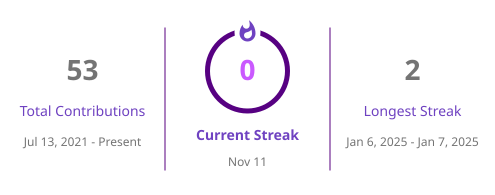
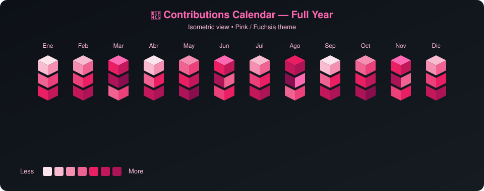

  

 

  
  
   
  
  

 

  
  

 

  

 

  <h2>📅 Contributions Calendar</h2>
  

 

---

  <h2>🛡️ About Me</h2>

  Estudiante avanzado de <b>Seguridad Informática</b> especializado en operaciones <b>Blue Team</b>, desarrollo web seguro e implementación de infraestructura IT. 
  <b>Bug Bounty Hunter</b> activo en HackerOne y programas privados. Diseño de prototipos de cifrado, monitoreo de amenazas y codificación segura.

 

---

  <h2>💼 Experience</h2>

<table width="100%">
  <tr>
    <td width="50%" valign="top" align="left">
      <h3>🔐 Security Prototype Developer & Bug Bounty Hunter</h3>
      <i>Independiente · 2023 – Presente</i>
      <ul>
        <li>Participación activa en Bug Bounty (HackerOne + privados)</li>
        <li>Análisis de vulnerabilidades y reportes profesionales</li>
        <li>Prototipos de cifrado web y monitoreo de amenazas</li>
        <li>Codificación segura (XSS, secrets management, almacenamiento cifrado)</li>
        <li>Backend Node.js + Frontend React con buenas prácticas</li>
        <li>Pentesting y recomendaciones de remediación</li>
      </ul>
    </td>
    <td width="50%" valign="top" align="left">
      <h3>🛠️ Freelance IT Infrastructure & Security Consultant</h3>
      <i>Independiente · 2023 – Presente</i>
      <ul>
        <li>Endurecimiento de redes (WPA2/WPA3 + segmentación)</li>
        <li>VPN seguras (IPSec y OpenVPN)</li>
        <li>Gestión de accesos con mínimo privilegio y RBAC</li>
        <li>Administración de servidores Linux / Windows</li>
        <li>Despliegue de VMs en VMware y VirtualBox</li>
        <li>Backups automatizados</li>
      </ul>
    </td>
  </tr>
</table>

 

---

  <h2>🎓 Education & Certifications</h2>
  
<b>Tecnicatura en Seguridad Informática</b>

  
  
  
  
  
    
  
  
  
  

 

---

  <h2>🛠️ Core Skills</h2>

<table width="100%">
  <tr>
    <td align="center" width="33%" valign="top">
      <h3>🛡️ Blue Team / Cyber</h3>
      <code>Wireshark</code> <code>Nmap</code> <code>OpenVAS</code> 
      <code>SIEM</code> <code>AES/RSA</code> <code>Pentesting</code> 
      <code>Bug Bounty</code> <code>Python Automation</code>
    </td>
    <td align="center" width="33%" valign="top">
      <h3>💻 Secure Development</h3>
      <code>JavaScript</code> <code>TypeScript</code> <code>React</code> 
      <code>Angular</code> <code>Node.js</code> <code>Python</code> 
      <code>HTML5</code> <code>CSS3</code> <code>SQL</code>
    </td>
    <td align="center" width="33%" valign="top">
      <h3>🌐 IT Infrastructure</h3>
      <code>TCP/IP</code> <code>VLAN</code> <code>VPN</code> 
      <code>Firewalls</code> <code>Linux</code> <code>Windows</code> 
      <code>VMware</code> <code>VirtualBox</code> <code>Backups</code>
    </td>
  </tr>
</table>

 

---

  <h2>🌐 Languages</h2>
  
  

 

  

